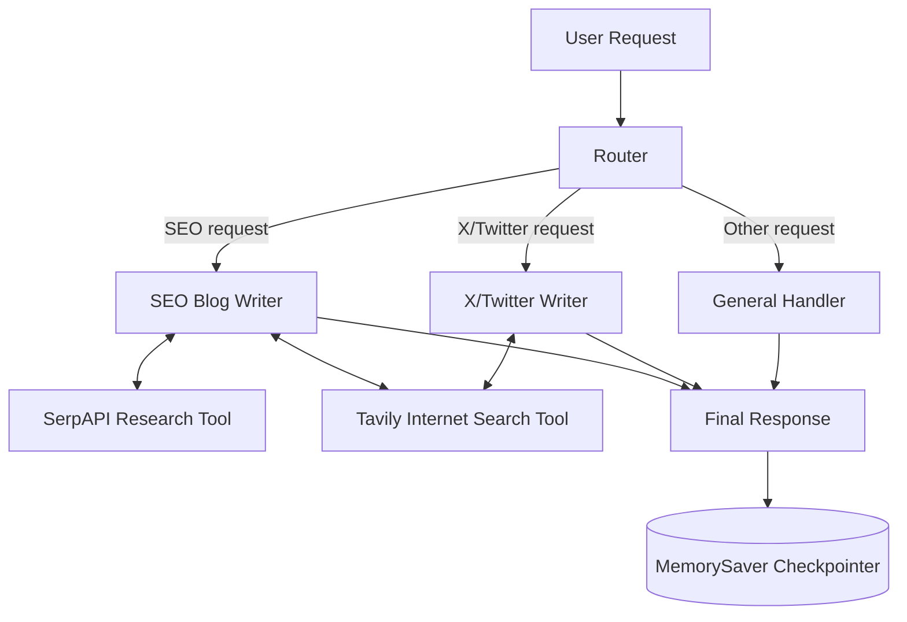

# 🧠 ContentFlow Agents

> A persistent LangGraph multi-agent system for intelligent SEO, social, and general content creation.

## Goal

Make content creation more useful and reliable by routing each request to the right specialist, allowing agents to research when needed, and preserving conversation context for follow-up requests.

## 1️⃣ Project Title & Value Proposition

**ContentFlow Agents — a multi-agent content assistant for marketers, creators, and teams, producing research-backed blog posts, concise X content, and context-aware answers.**

## 2️⃣ Background & Problem Context

Content teams regularly switch between long-form SEO writing, short-form social publishing, research, and everyday content questions. These tasks have different constraints:

- Blog writing requires research, structure, keywords, and a strong call to action.
- X/Twitter writing requires brevity, current context, emojis, and hashtags.
- General requests require conversational memory and flexible answers.

A single undifferentiated prompt often produces inconsistent results, wastes tool calls, and loses context across follow-up requests. ContentFlow Agents routes each request to a specialized agent with the tools and instructions appropriate for that task.

## 3️⃣ Target User & Job To Be Done (JTBD)

- **Primary users:** Content marketers, SEO writers, social media managers, founders, and independent creators.
- **Secondary users:** Product and engineering teams evaluating practical multi-agent workflows.
- **JTBD:** Turn a natural-language content request into a useful, appropriately formatted response while minimizing unnecessary research and retaining conversation context.

## 4️⃣ Why an Agentic Approach (Very Important)

Scripts and fixed workflows are insufficient because the system must decide dynamically:

- Which specialist should handle the request.
- Whether current information or deeper research is necessary.
- Which search query best supports the requested content.
- Whether more tool calls are needed before producing a final answer.
- How to preserve context for follow-up questions.

The router and specialist agents use reasoning to select actions, while LangGraph provides explicit orchestration and controllable tool-calling loops.

## 5️⃣ Agent Role, Scope & Autonomy Level

### Agent responsibilities

- **Router:** Classifies requests as `seo_blog_writer`, `x_blog_writer`, or `general`.
- **SEO Blog Writer:** Produces structured, research-backed long-form blog posts.
- **X/Twitter Writer:** Produces posts under 280 characters with emojis and hashtags.
- **General Handler:** Answers other questions using the full conversation history.

### Autonomy boundaries

- Agents may search the internet using their assigned tools.
- Agents decide whether a tool call is needed and whether to continue the loop.
- Users review and approve generated content before publishing.
- The system does not publish content or perform external side effects.

## 6️⃣ Agent Architecture & Components



### a) Planner / Decision Layer

The router performs the first classification. Each specialist agent then decides whether to call an available tool, inspect the result, call another tool, or finish.

### b) Executors / Sub-Agents

- **SEO Blog Writer:** Uses SerpAPI for articles and references and Tavily for keywords, trends, and supporting searches.
- **X/Twitter Writer:** Uses Tavily for current topics and hashtags.
- **General Handler:** Uses the shared conversation state without external tools.

### c) Memory

- **Short-term memory:** LangGraph state and the `messages` reducer.
- **Session persistence:** `MemorySaver` keyed by `thread_id`.
- **Long-term storage:** Not currently implemented.

### d) Orchestration Logic

Conditional edges route requests to the correct agent. `ToolNode` executes tool calls, then routes results back to the originating agent until the agent returns a final response.

## 7️⃣ End-to-End Agent Workflow

1. Receive a user request.
2. Store the request in the shared message state.
3. Classify the request with the router.
4. Send it to the SEO, X/Twitter, or general agent.
5. Let the specialist decide whether research or internet search is needed.
6. Execute requested tools.
7. Return tool results to the same agent for continuation.
8. Generate and store the final response.
9. Reuse the same `thread_id` for future context-aware requests.

## 8️⃣ Tools, Models & Stack (With Rationale)

| Component | Technology | Rationale |
|---|---|---|
| Orchestration | LangGraph | Explicit state, routing, loops, and checkpointing |
| LLM | ChatOpenAI | Tool calling and reliable instruction following |
| Deep research | SerpAPI / Google Scholar | Articles, academic papers, and references |
| Internet search | Tavily | Lightweight searches for keywords, trends, and current topics |
| State | `TypedDict` + `add_messages` | Shared typed state with append-only message updates |
| Persistence | `MemorySaver` | Simple thread-based session memory during runtime |

## 9️⃣ Evaluation Strategy & Metrics

- **Routing accuracy:** Percentage of requests sent to the correct agent.
- **Tool success rate:** Percentage of tool calls returning usable results.
- **Content compliance:** Blog structure, CTA presence, and X post length under 280 characters.
- **Response quality:** Human ratings for relevance, factual usefulness, clarity, and tone.
- **Latency:** Time from request to final response, including tool calls.
- **Cost per run:** LLM and search-tool usage per request.
- **Memory accuracy:** Success rate for follow-up questions that depend on prior context.

## 🔟 Guardrails, Trust & Safety

- The X/Twitter agent must keep final posts under 280 characters.
- Tool access is limited by agent: SEO can use both tools, while X/Twitter can use Tavily only.
- The system should distinguish retrieved information from verified facts before publication.
- Users review generated content before publishing.
- API keys are entered securely and should not be committed to the repository.
- Tool errors should result in a graceful fallback or an explicit limitation.

## 1️⃣1️⃣ Failure Modes & Tradeoffs

- **Incorrect routing:** Ambiguous requests may be sent to the general handler.
- **Search quality variance:** External search results may be incomplete, stale, or noisy.
- **Tool cost:** Repeated research calls can increase latency and API spend.
- **Memory scope:** `MemorySaver` is in-memory and does not survive process restarts.
- **Character overflow:** Emojis and hashtags can cause an X post to exceed the limit.
- **Model variability:** The same request may produce different wording across runs.

The system favors transparent, controllable orchestration over fully autonomous publishing.

## 1️⃣2️⃣ Results, Learnings & Insights

- Specialized prompts produce clearer output constraints than one general content prompt.
- Tool-calling loops allow research depth to adapt to the request.
- Routing and tool access should remain explicit so cost and behavior are easier to evaluate.
- A shared message state makes follow-up questions possible without duplicating conversation logic across agents.

## 1️⃣3️⃣ Future Improvements & Iteration Plan

- Add a production checkpointer backed by a database.
- Add structured output validation for routes and content length.
- Add citations and source attribution to research-backed blog posts.
- Add automated evaluation datasets for routing and content quality.
- Add observability for tool calls, latency, token usage, and failures.
- Add human approval workflows before publishing.
- Add separate agents for editing, fact-checking, and content repurposing.

## 1️⃣4️⃣ Demo & Artifacts

Example requests:

```text
Write a long-form SEO blog post about the benefits of renewable energy.
Write an engaging X post about artificial intelligence trends.
What was my last request?
```

The graph uses a stable `thread_id` for each conversation:

```python
config = {
    "configurable": {
        "thread_id": "user-1"
    }
}

result = graph.invoke(
    {
        "user_input": "What was my last request?",
        "route": "",
        "output": "",
        "messages": [],
    },
    config=config,
)

print(result["output"])
```

## 1️⃣5️⃣ Role-Based Signal (Mandatory)

- **For PMs:** Demonstrates problem framing, task-specific experiences, cost-aware tool usage, and measurable content outcomes.
- **For EMs:** Demonstrates stateful orchestration, conditional routing, bounded autonomy, tool loops, and a path toward production persistence.
- **For SWEs:** Demonstrates modular agents, typed shared state, reusable tools, graph-based control flow, and testable route behavior.

## 🚀 Setup

Install dependencies:

```bash
pip install -U langgraph langchain langchain-openai serpapi tavily-python typing-extensions
```

Configure the required API keys through the secure prompts in `config.py` and `tools.py`:

- `OPENAI_API_KEY`
- `SERPAPI_KEY`
- `TAVILY_API_KEY`

Never commit API keys to the repository.

